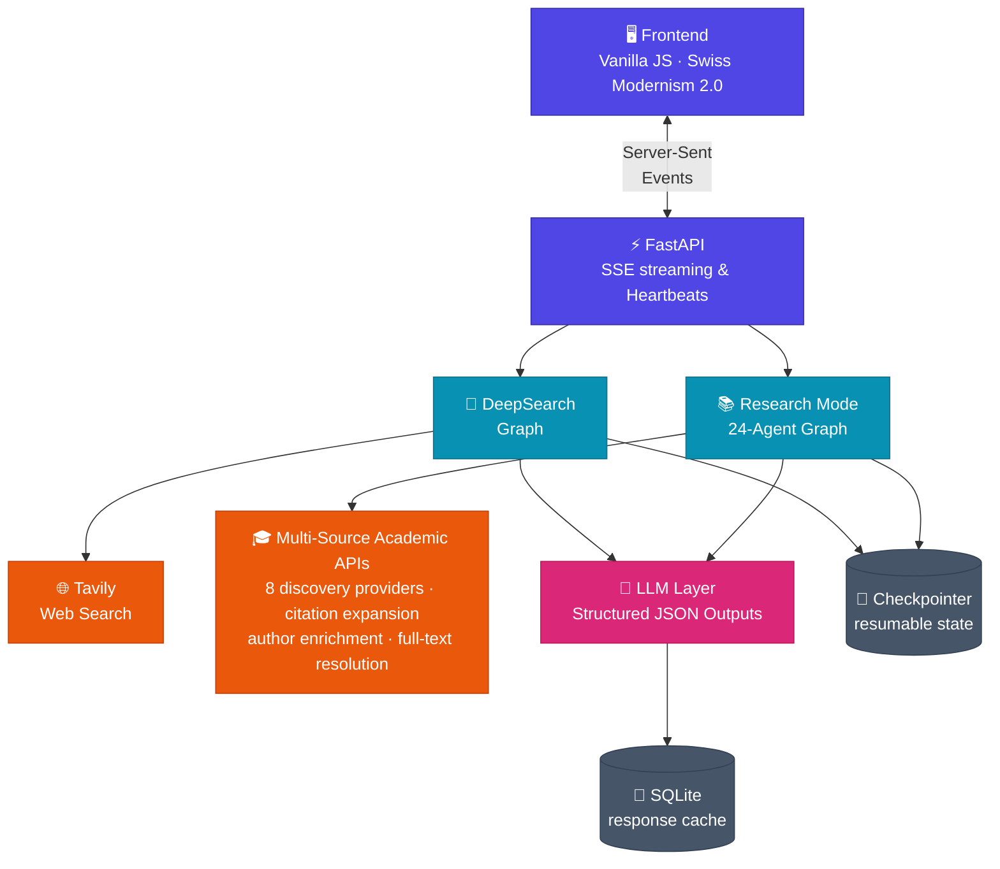

#  CiteProof

**Audit tools for AI literature reviews.** CiteProof checks that a review's citations, quotes, counts and risk-of-bias judgements hold up. It comes in two parts: an **MCP server** for Claude Science and other research agents, and a full **research assistant app** that writes evidence-grounded papers.


[](https://www.npmjs.com/package/citeproof-mcp)
[](https://github.com/Aryan-Pardeshi/CiteProof-AI-MCP/releases/latest)
[](https://github.com/Aryan-Pardeshi/CiteProof-AI-MCP/actions/workflows/mcp-npm.yml)
[](LICENSE)

```bash
npx -y citeproof-mcp
```

<p align="center">
  <a href="https://citeproof.top/"></a>
</p>

**🔗 Research Web → [CiteProof.top](https://citeproof.top/)**

## Contents

- [What is CiteProof?](#what-is-citeproof)
- [CiteProof MCP](#citeproof-mcp)
  - [What it checks](#what-it-checks)
  - [Quick start](#quick-start)
  - [Companion skill](#companion-skill)
  - [The 24 tools](#the-24-tools)
  - [What it does not do](#what-it-does-not-do)
- [CiteProof Research (the app)](#citeproof-research-the-app)
  - [Two modes](#two-modes)
  - [Architecture](#architecture)
  - [Research pipeline](#research-pipeline)
  - [3 human-in-the-loop quality gates](#3-human-in-the-loop-quality-gates)
  - [Academic integrity and research invariants](#academic-integrity-and-research-invariants)
  - [Tech stack](#tech-stack)
  - [Academic API coverage](#academic-api-coverage)
  - [Getting started](#getting-started)
- [Repository layout](#repository-layout)
- [Contributing](#contributing)
- [Licence](#licence)
- [Star history](#star-history)

---

## What is CiteProof?

AI research agents are now good at finding and reading papers. They are less good at proving their work: which databases were searched, how many records were screened, whether a quoted sentence is really in the paper, whether two reviewers agreed. CiteProof is built around that gap.

| | **CiteProof MCP** | **CiteProof Research** |
|---|---|---|
| **What it is** | An MCP server with 24 audit tools | A web app with a 24-agent research pipeline |
| **Who does the research** | Your agent (Claude Science, or any MCP client) | The app's own agents |
| **Language model inside** | None. It needs no API key | Yes, any OpenAI-compatible endpoint |
| **Best for** | Systematic reviews that need an audit trail | Fast cited reports and full evidence-grounded papers |
| **Where it lives** | [`MCP/`](MCP/) | `backend/`, `frontend/` |

A small first benchmark (two reviews against Claude Science) showed that agents with strong search find far more of the known included studies than CiteProof Research does. That is why the MCP server does not try to search: it audits the work of the agent that does.

---

## CiteProof MCP

CiteProof MCP keeps the records a systematic review needs and checks them: a protocol, a PRISMA record, a screening log, an evidence table, claim checks, risk-of-bias records and an exportable audit trail. It works with [Claude Science](MCP/docs/CLAUDE_SCIENCE.md) and with other tools that can run a stdio MCP server, such as research agents and desktop AI clients.

The server has no language model inside. The agent searches, reads, decides and writes. The server stores each decision, checks the evidence it points to, computes the numbers and refuses bad input.

Full documentation: [MCP/README.md](MCP/README.md) · tool reference: [MCP/docs/SPEC.md](MCP/docs/SPEC.md).

### What it checks

| Check | How |
|---|---|
| A quote really appears in the source text | The agent sends the quote and the text. The server matches them after normalising case, whitespace, quotes, dashes and line-break hyphens, on word boundaries. The result is stored as `quote_verified`. |
| Numbers in the evidence table come from the quote | Sample size, estimate and confidence limits must be written in the quote. Estimates outside their interval are refused. |
| PRISMA numbers add up | Counts come from the recorded searches, the deduplication step and the screening decisions, and the flow invariants are checked on every call. |
| Two reviewers agree | Cohen's kappa over the papers both reviewers decided, with the disagreements listed. |
| DOIs exist and are not retracted | Crossref and doi.org lookups. An unreachable registry gives "unverified", never "not found". |
| Citations match the reference list | In-text citations are matched by DOI, author and year, or title. "Resolved" means matched, not supported. |
| Risk-of-bias overall judgements follow the published rules | RoB 2, ROBINS-I and Newcastle-Ottawa (AHRQ thresholds). |
| Duplicates | Deterministic clustering by DOI, PMID, then title plus year plus first author. |

### Quick start

One command, in any MCP client that runs local (stdio) servers:

```bash
npx -y citeproof-mcp
```

The [`citeproof-mcp`](https://www.npmjs.com/package/citeproof-mcp) npm package is a small launcher. It finds [uv](https://docs.astral.sh/uv/) (or installs it, unless `CITEPROOF_NO_AUTO_INSTALL=1`), then runs the Python server from the wheel attached to the matching [GitHub release](https://github.com/Aryan-Pardeshi/CiteProof-AI-MCP/releases/latest). You need Node.js 18 or newer. Python and git are not required: uv downloads Python 3.12 when needed.

| Client | How to add CiteProof MCP | Status |
|---|---|---|
| **Claude Science** | Customize → Connectors → Add connector → **Local command**. Name `citeproof`, command `npx -y citeproof-mcp`. | npx install tested on Claude Science 0.1.70 (Windows 11, 24 tools listed); bundle install tested on 0.1.67 |
| **Claude Desktop** | Download [`citeproof.mcpb`](https://github.com/Aryan-Pardeshi/CiteProof-AI-MCP/releases/latest/download/citeproof.mcpb) and open it (Settings → Extensions), or add the JSON below to `claude_desktop_config.json`. | New in 0.2.0 |
| **Claude Code** | `claude mcp add citeproof -- npx -y citeproof-mcp` | New in 0.2.0 |
| **Cursor, VS Code, Windsurf, other clients** | Add the JSON below to the client's MCP settings (VS Code: the `servers` form further down). | Not yet tested |

```json
{
  "mcpServers": {
    "citeproof": {
      "command": "npx",
      "args": ["-y", "citeproof-mcp"]
    }
  }
}
```

VS Code's built-in MCP support (`.vscode/mcp.json` or your user MCP settings) uses `servers` instead of `mcpServers`:

```json
{
  "servers": {
    "citeproof": {
      "type": "stdio",
      "command": "npx",
      "args": ["-y", "citeproof-mcp"]
    }
  }
}
```

Everything runs on your computer. Review files go to `CITEPROOF_MCP_HOME`, or to `~/.citeproof-mcp` when it is not set. The server's only network calls are DOI and retraction lookups to Crossref and doi.org. On first run the launcher also downloads its own files: the npm package, and, when no compatible Python is found, uv, Python 3.12 and the server wheel. claude.ai custom connectors need a remote server, so they are not supported.

If Claude Science reports that a file is not readable inside its sandbox, set `CITEPROOF_UV_HOME` (Advanced settings → environment variables) to a folder inside the connector's workspace, so uv keeps its cache and Python there. The older bundle install in [MCP/docs/CLAUDE_SCIENCE.md](MCP/docs/CLAUDE_SCIENCE.md) still works.

<details>
<summary>Install from source with pip</summary>

```bash
pip install ./MCP
```

Then point the client at the `citeproof-mcp` command (stdio), optionally with `"env": { "CITEPROOF_MCP_HOME": "/path/to/your/review-data" }`.

</details>

### Companion skill

[`MCP/skills/citeproof-review`](MCP/skills/citeproof-review/SKILL.md) teaches an agent the review workflow and the tool order. Install steps for Claude Code, Claude Desktop and Claude Science are in [MCP/skills/README.md](MCP/skills/README.md). A reviewer-instructions snippet for Claude Science is in [MCP/docs/REVIEWER_SNIPPET.md](MCP/docs/REVIEWER_SNIPPET.md).

### The 24 tools

| Group | Tools |
|---|---|
| Set up and status | `review_create`, `review_list`, `protocol_record`, `review_status` |
| Searches and duplicates | `prisma_record_search`, `dedup_papers`, `prisma_record_dedup` |
| Screening | `screening_record`, `screening_record_many`, `screening_list`, `screening_agreement` |
| PRISMA | `prisma_status`, `prisma_flow_diagram`, `prisma_checklist` |
| Evidence and bias | `evidence_record`, `evidence_table`, `claim_record`, `claim_report`, `rob_record`, `rob_summary` |
| Citations and prose | `verify_dois`, `resolve_citations`, `lint_prose` |
| Export | `export_bundle` |

### What it does not do

- It does not search for papers. Use your agent's search, or the CiteProof Research app below.
- It does not judge anything. A label such as "supported" is the agent's judgement. The server only checks that the quote is in the text.
- It does not read PDFs. The agent supplies the text.
- The PRISMA checklist and the report number check are keyword checks. They show what is mentioned, not whether it is reported well.

---

## CiteProof Research (the app)

An AI-powered multi-agent research workspace with **two modes**: fast web research that returns a cited report, and a full evidence-grounded academic pipeline that writes complete research papers whose cited claims link back to source passages, with human-in-the-loop quality gates.

### Two modes

| | **DeepSearch** | **Research Mode (Evidence-First)** |
|---|---|---|
| **Goal** | Answer a question from the live web | Write a full, evidence-grounded academic paper |
| **Sources** | Tavily web search | OpenAlex · Semantic Scholar · Crossref · PubMed · arXiv · Europe PMC · DOAJ · DataCite · OpenCitations |
| **Agents** | 5 (fan-out parallel researchers) | 24 specialized agents across 5 evidence phases |
| **HITL Checkpoints** | 1 (plan approval) | 3 Quality Gates (Protocol, Evidence Corpus, Hypotheses) |
| **Data Invariant** | LLM web summary | Deterministic `EvidenceRecord` store (quotes, metrics, baselines) |
| **PRISMA Tracking** | N/A | Deterministic PRISMA 2020 flow counts & assertions |
| **Integrity Audit** | Citation regex | Automated citation & numerical claim grounding verification |
| **Runtime** | ~1-2 min | ~5-15 min |
| **Output** | Structured markdown report | Full paper + PRISMA flow chart + evidence mapping matrix |
| **Export** | `.md` | `.pdf` · `.docx` |

### Architecture

Both modes run as separate LangGraph state machines behind one FastAPI backend, sharing the LLM layer, checkpointer, and SSE streaming transport.



### Research pipeline

**Research question → Scope & protocol → Literature retrieval → Evidence extraction → Synthesis → Validation & export**

`24 specialized agents · 5 phases · 3 human approval gates`

### 3 human-in-the-loop quality gates

Each gate genuinely pauses graph execution via LangGraph `interrupt()`, allowing the author to approve or request targeted revisions in natural language:

| Gate | Phase | Review Artifacts | Guarantees |
|---|---|---|---|
| **Gate 1: Planning & Protocol** | Phase 1 | PICOC Protocol, Objectives, Research Questions, Boolean Keywords | Prevents query divergence before initiating multi-source retrieval |
| **Gate 2: Evidence & Corpus** | Phase 3 | PRISMA Flow Tracker, Screened Literature, Extracted Evidence Records | Verifies empirical grounding before theoretical synthesis begins |
| **Gate 3: Hypotheses & Framework** | Phase 4 | Conceptual Framework, Research Gaps, Formulated Hypotheses (H1..H5) | Confirms theoretical validity before committing to full paper generation |

### Academic integrity and research invariants

1. **Deterministic Flow-Tracking State Machine (PRISMA 2020-aligned)**:
   `PRISMATracker.validate_invariants()` asserts these *internal* conservation relations:
   ```python
   records_identified - duplicates_removed     == records_after_dedup
   records_screened   - excluded_title_abstract == full_text_requested
   full_text_assessed - excluded_full_text      == studies_included
   ```
   `full_text_requested` is the tracker's internal shortcut for PRISMA's *reports sought for retrieval*. The distinct PRISMA stages *reports not retrieved* (`full_text_unavailable`) and *reports assessed for eligibility* (`full_text_assessed`) are tracked as separate fields, but the hand-off between them is not asserted—so the equations above are internal invariants rather than the complete PRISMA 2020 flow. Every count is tracked deterministically in code—never generated or estimated by an LLM.

2. **Immutable Evidence Store**:
   - `PaperRecord.paper_id`: first 16 hex characters of a SHA-256 digest (a truncated representation, not the full digest) computed over a source-qualified key: `doi:<canonicalized DOI>` when a DOI is available, otherwise `title:<normalized title>:<year>`. Normalized titles are not assumed unique, so the fallback key also folds in the publication year (`nd` when unknown).
   - `EvidenceRecord.evidence_id`: deterministic composite identifier `{paper_id}_ev001` (the composite is not itself hashed) anchoring exact quote, metric, baseline value, and effect direction.
   - `ReviewClaim.claim_id`: deterministic composite identifier `{section}_cl001` (section slug truncated to 8 characters) linking paper claims to supporting evidence IDs.

3. **Deterministic Validation Pipeline**:
   - `citation_validator`: Resolves every in-text citation against known `PaperRecord` metadata and every `ReviewClaim` through its claim → evidence → paper → DOI/URL chain; flags citations and claims that do not resolve. This is a resolution check only: it does not test that the cited passage supports the sentence, so a resolving claim is marked `resolved`, never `verified`.
   - `claim_validator`: Matches numbers in quantitative sentences against extracted `EvidenceRecord` benchmark metrics (numeric match only).
   - `integrity_auditor`: Validates PRISMA invariants and issues comprehensive `ValidationReport`; `passed_all_gates` means the resolution and numeric-match gates passed, not that sources support the prose.

### Tech stack

| Layer | Technology |
|---|---|
| **Orchestration** | LangGraph (StateGraph, `interrupt()` HITL, `Send()` fan-out, SQLite persistence) |
| **Structured LLM** | Pydantic v2 schemas + `ainvoke_structured_with_retry` |
| **Academic Sources** | OpenAlex, Semantic Scholar, Crossref, PubMed, arXiv, Europe PMC, DOAJ, DataCite, OpenCitations |
| **Author Enrichment** | Optional ORCID author-name canonicalization |
| **Full-Text Ingestion** | Unpaywall → Europe PMC → CORE fallback chain |
| **Backend API** | FastAPI + Server-Sent Events (SSE) with keep-alive heartbeats |
| **Frontend UI/UX** | Vanilla JS + CSS (Swiss Modernism 2.0, zero-build, responsive) |
| **Figures & Charts** | matplotlib (PRISMA 2020 Flowchart, Hypothesis Evidence Matrix) |
| **Document Export** | FPDF2 (`.pdf` with hanging APA indents) · python-docx (`.docx`) |
| **MCP server** | `mcp` SDK (1.27 and 2.x), SQLite, Pydantic v2, httpx |

### Academic API coverage

Research Mode uses each academic API for a specific stage:

| API | Role | Configuration |
|---|---|---|
| **OpenAlex** | Literature discovery and open-access metadata | `OPENALEX_EMAIL` |
| **Semantic Scholar** | Literature discovery and citation metadata | Optional `SEMANTIC_SCHOLAR_API_KEY` |
| **Crossref** | Literature discovery and DOI metadata resolution | Uses `OPENALEX_EMAIL` for polite-pool requests |
| **PubMed (NCBI E-utilities)** | Biomedical literature discovery | `NCBI_EMAIL` and `NCBI_TOOL_NAME`; optional `NCBI_API_KEY` |
| **arXiv** | Preprint discovery | No credentials |
| **Europe PMC** | Biomedical discovery and full-text fallback | No credentials |
| **Directory of Open Access Journals (DOAJ)** | Open-access journal discovery | No credentials |
| **DataCite** | Research-output and dataset discovery | No credentials |
| **OpenCitations** | Forward and backward citation-graph expansion | No credentials |
| **ORCID** | Optional author identity enrichment | Set `ORCID_AUTHOR_ENRICHMENT=1` |
| **Unpaywall** | Open-access PDF resolution | Uses `OPENALEX_EMAIL` |
| **CORE** | Optional full-text fallback | Optional `CORE_API_KEY` |

### Getting started

#### 1. Clone and configure

```bash
git clone https://github.com/Aryan-Pardeshi/CiteProof-AI-MCP.git
cd CiteProof-AI-MCP
cp .env.example .env
```

Minimum `.env` configuration:

```bash
LLM_API_KEY="your_api_key_here"
LLM_BASE_URL="https://api.deepseek.com"
TAVILY_API_KEY="your_tavily_key_here"
OPENALEX_EMAIL="you@example.com"
NCBI_EMAIL="you@example.com"
NCBI_TOOL_NAME="your_tool_name"
```

Optional academic API configuration:

```bash
SEMANTIC_SCHOLAR_API_KEY="your_api_key_here"
NCBI_API_KEY="your_api_key_here"
CORE_API_KEY="your_api_key_here"
ORCID_AUTHOR_ENRICHMENT=0
```

#### 2. Run with Docker

```bash
docker compose up -d --build
```

Access the UI at **[http://localhost:8000](http://localhost:8000)**.

#### 3. Local development

```bash
python -m venv .venv
.venv\Scripts\activate      # Windows (or source .venv/bin/activate on Unix)
pip install -r requirements.txt
uvicorn backend.app.main:app --reload --port 8000
```

---

## Repository layout

| Folder | What is in it |
|---|---|
| [`MCP/`](MCP/) | CiteProof MCP: the server package `citeproof_mcp`, its tests and docs, the npm launcher (`MCP/npm`), the Claude Desktop extension (`MCP/mcpb`), the companion skill (`MCP/skills`) and the Claude Science install script |
| `backend/` | CiteProof Research: FastAPI app, LangGraph agents, academic API adapters |
| `frontend/` | The web UI (vanilla JS, no build step) |
| `tests/` | Offline tests for the app (`pytest`) |
| `docs/` | Design notes for the app |
| `scripts/` | Helper scripts for the app |

---

## Contributing

Contributions are welcome, from typo fixes to new academic source adapters and new MCP checks. Start with [CONTRIBUTING.md](CONTRIBUTING.md) for setup and a project map, then pick an issue labelled [`good first issue`](https://github.com/Aryan-Pardeshi/CiteProof-AI-MCP/labels/good%20first%20issue) or [`help wanted`](https://github.com/Aryan-Pardeshi/CiteProof-AI-MCP/labels/help%20wanted). The test suites run offline with `pytest`: run `pytest --ignore=MCP` from the repository root for the app, and `python -m pytest` inside `MCP/` for the MCP server.

---

## Licence

MIT, see [LICENSE](LICENSE). Two files inside the MCP server are adapted from Anthropic's Claude Science under the Apache License 2.0; see [MCP/NOTICE.md](MCP/NOTICE.md).

---

## Star History

<a href="https://www.star-history.com/?repos=aryan-pardeshi%2Fciteproof-ai-mcp&type=date&legend=top-left">
 <picture>
   <source media="(prefers-color-scheme: dark)" srcset="https://api.star-history.com/chart?repos=aryan-pardeshi/citeproof-ai-mcp&type=date&theme=dark&legend=top-left" />
   <source media="(prefers-color-scheme: light)" srcset="https://api.star-history.com/chart?repos=aryan-pardeshi/citeproof-ai-mcp&type=date&legend=top-left" />
   
 </picture>
</a>
